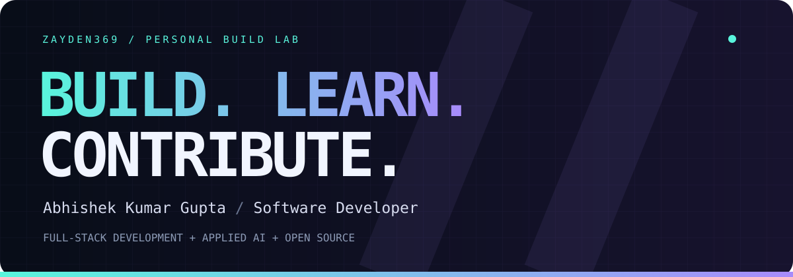
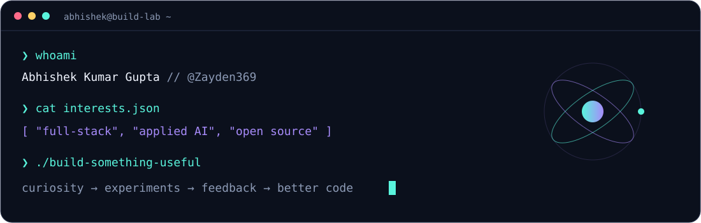
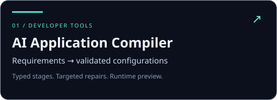
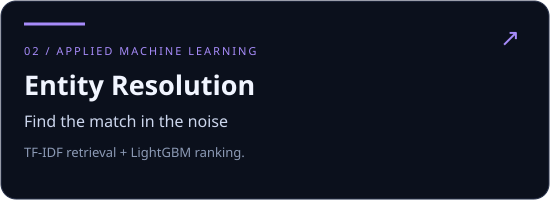
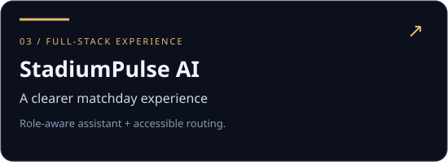
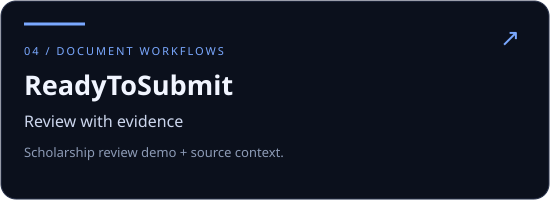

  

  
  
  

<b>Curiosity gets me started. Building keeps me hooked.</b> 
I turn ideas into interfaces, experiments into projects, and review feedback into better code.

### 01 / Behind the handle

I'm **Abhishek**, a B.Tech CSE student at **Dev Bhoomi Uttarakhand University**, Class of **2028**. I enjoy the whole process: understanding a problem, exploring the design, building the product, and fixing the details that make it work.

- **Building across:** full-stack web applications, developer tools, and applied machine learning.
- **Contributing to:** the Layer5 / Meshery ecosystem, from documentation and SEO to CLI validation and tests.
- **How I learn:** pick an interesting problem, go deep, build something, and keep improving it.
- **Let's build:** useful tools, thoughtful interfaces, and open-source projects with room to learn.

### 02 / Selected builds

<table>
<tr>
<td width="50%" valign="top">

Natural-language requirements → validated application configurations → a runnable React preview. Typed stages, cross-layer checks, and targeted repairs.

<code>Next.js</code> <code>TypeScript</code> <code>Zod</code> <code>AI SDK</code>

<a href="https://github.com/Zayden369/ai-application-compiler"><b>Explore the compiler ↗</b></a>
</td>
<td width="50%" valign="top">

A retrieval-and-ranking pipeline for noisy business records. TF-IDF candidate generation meets LightGBM ranking, with a synthetic demo for reproducibility.

<code>Python</code> <code>TF-IDF</code> <code>LightGBM</code>

<a href="https://github.com/Zayden369/amazon-ml-2026-entity-resolution"><b>Inspect the pipeline ↗</b></a>
</td>
</tr>
<tr>
<td width="50%" valign="top">

A stadium-operations demo with a role-aware assistant, accessible routing, and crowd dashboards, built around clearly labeled mock venue data.

<code>React</code> <code>Express</code> <code>Vitest</code>

<a href="https://github.com/Zayden369/StadiumPulse_AI"><b>Enter the project ↗</b></a>
</td>
<td width="50%" valign="top">

A scholarship-document review experience with source evidence and deterministic checks. Live frontend and Sample Mode; AWS extraction infrastructure is not yet deployed.

<code>AWS infrastructure</code> <code>Textract design</code> <code>Document review</code>

<a href="https://github.com/Zayden369/ReadyToSubmit"><b>View the source ↗</b></a> · <a href="https://readytosubmit.vercel.app"><b>Try Sample Mode ↗</b></a>
</td>
</tr>
</table>

### 03 / Open source, with receipts

Code review, small fixes, follow-through. A few contributions from the **Layer5 / Meshery** ecosystem:

| Contribution | What changed |
| :--- | :--- |
| [mesheryctl-axi #61](https://github.com/meshery-extensions/mesheryctl-axi/pull/61) | Reject malformed pagination flags before configuration access or server requests; add parser and command coverage. |
| [mesheryctl-axi #52](https://github.com/meshery-extensions/mesheryctl-axi/pull/52) | Update the quickstart around the published npm workflow. |
| [Layer5 #8059](https://github.com/layer5io/layer5/pull/8059) | Repair social-preview images and add validation. |
| [Layer5 #8058](https://github.com/layer5io/layer5/pull/8058) | Correct Careers and Members metadata errors. |

<a href="https://github.com/pulls?q=is%3Apr+author%3AZayden369+is%3Amerged"><b>Follow the contribution trail →</b></a>

### 04 / Tools in the lab

Tools used across my projects — always learning what the next problem needs.

### 05 / The contribution arcade

<picture>
  <source media="(prefers-color-scheme: dark)" srcset="https://raw.githubusercontent.com/Zayden369/Zayden369/output/github-snake-dark.svg" />
  <source media="(prefers-color-scheme: light)" srcset="https://raw.githubusercontent.com/Zayden369/Zayden369/output/github-snake.svg" />
  
</picture>

<b>06 / A little more about how I build</b>

I start with the problem, research similar products, and sketch the experience. Then I explore visual references, build a working version, and iterate through feedback and testing.

I'm especially interested in the overlap between **good interfaces**, **useful AI**, and **developer experience**. I also qualified for my college's internal **Smart India Hackathon** selection.

---

<b>Have an interesting problem? Let's build something useful.</b> 
<a href="https://abhishek-gupta-portfolio-orpin.vercel.app/">Visit my portfolio</a> · <a href="https://github.com/Zayden369?tab=repositories">Explore my work</a>

Made with curiosity. Improved through feedback.

